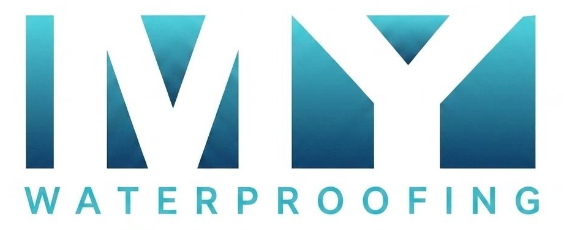

<div align="center">

  

  # MY Waterproofing Pune
  ### Leakage Solution Specialist • Serving Pune & PCMC Since 2010

  [](https://github.com/Sourabh-50/my-waterproofing-website)
  [](https://github.com/Sourabh-50/my-waterproofing-website)
  [](https://github.com/Sourabh-50/my-waterproofing-website)
  [](https://vitejs.dev/)

  <p align="center">
    Official high-performance web platform for <strong>MY Waterproofing</strong> — Pune's engineering leader in <strong>non-destructive pressure injection grouting (100% zero tile breaking)</strong>, elastomeric terrace membranes, crack filling, and high-build polymer waterproofing.
  </p>

  <p align="center">
    <a href="#-core-specializations">Core Services</a> •
    <a href="#-website-pages--architecture">Pages</a> •
    <a href="#-tech-stack">Tech Stack</a> •
    <a href="#-getting-started">Getting Started</a> •
    <a href="#-deployment-to-aws-s3">S3 Deployment</a> •
    <a href="#-contact">Contact</a>
  </p>

</div>

---

## 🏗️ Core Specializations

| Service Category | Engineering Approach | Guarantee / Benefit |
| :--- | :--- | :--- |
| **Bathroom & Toilet Leakage** | Non-destructive chemical pressure injection grouting | **100% No Tile Removal**, zero structural demolition |
| **Terrace & Roof Waterproofing** | Multi-coat elastomeric & polyurethane UV-resistant coating | Seamless waterproof barrier against intense Pune monsoons |
| **External Wall Waterproofing** | Fiber-mesh bridging & high-build hydrophobic polymer coatings | Eliminates capillary rainwater seepage into interior bedrooms |
| **Kitchen & Balcony Treatment** | Slab-packer injection grouting & perimeter tile sealing | Stops concealed moisture from dripping to lower floors |
| **Overhead Water Tanks & Parapets** | Potable-safe non-toxic cementitious crystalline coatings | Restores internal concrete without toxic chemical residues |
| **Structural Crack & Joint Repair** | Deep-penetrating polyurethane elastomeric joint sealants | Withstands thermal expansion & building settling movement |

---

## 🌟 Website Features & Architecture

- **Multi-Page Static Architecture**:
  - `index.html` — Homepage featuring instant interactive diagnosis, before/after interactive image comparison slider, cost & timeline estimator, Pune customer reviews marquee stripe, and inspection booking modal.
  - `about.html` — Company legacy, core milestones (2010–present), technical methodology, non-destructive philosophy, and certified engineer team.
  - `gallery.html` — Real-world photographic case studies across Pune & PCMC societies (Amanora, Baner, Kothrud, Kharadi, Wakad, Viman Nagar).
  - `404.html` — Witty waterproofing-themed error page with custom animated dripping valve pipe and instant redirect to safety.
- **Glassmorphic Dark Obsidian Design System**:
  - Pure Vanilla CSS with tailored HSL color tokens (`#0a0c10` obsidian base, `#fbbf24` amber gold, `#38bdf8` cyan accent).
  - Subtle micro-animations, glass elevation navbar, and hardware-accelerated transforms.
  - Mobile drawer navigation with background body scroll locking (`lockBacksideScroll()`).
- **Performance & Asset Optimization**:
  - Dual-format next-gen media delivery (`<picture>` with `.webp` primary and `.jpg` fallback).
  - Clean separation of lightweight web assets from heavy raw camera archives.
  - Sub-350ms build time with Vite multi-page Rollup bundling.
- **SEO & Search Standards**:
  - Google-indexed semantic HTML5 markup with OpenGraph, Twitter Cards, and schema.org microdata.
  - Valid `sitemap.xml` and `robots.txt` configuration.
  - Multi-resolution square favicon suite (`16x16`, `32x32`, `48x48`, `64x64`, `180x180`, `192x192`).

---

## 💻 Tech Stack

- **Frontend**: Semantic HTML5, Vanilla Modern CSS3 (Grid, Flexbox, CSS Variables, Glassmorphism), Vanilla ES6+ JavaScript.
- **Tooling & Bundler**: [Vite](https://vitejs.dev/) with Multi-Page Rollup configuration (`vite.config.ts`).
- **Typography**: [Google Fonts](https://fonts.google.com/) — *Outfit* (bold geometric headings) + *Inter* (crisp high-legibility body).
- **Icons**: Handcrafted inline SVG vector icons with solid geometry for high DPI retina screens.

---

## 📁 Repository Directory Structure

```text
MyWaterProofingWebsite/
├── index.html                  # Main homepage (Services, Diagnosis, Estimator, Reviews)
├── about.html                  # About Us (Company history, team, methodology)
├── gallery.html                # Project Gallery (10 authentic Pune case studies)
├── 404.html                    # Creative 404 Leaky Pipe Error Page
├── vite.config.ts              # Vite multi-page build configuration
├── package.json                # Project scripts and dependencies
├── .gitignore                  # Production ignore rules (excludes heavy raw media)
│
├── css/
│   └── style.css               # Unified responsive design system & animations
│
├── js/
│   └── script.js               # Interactive calculators, modal logic, navigation
│
├── images/                     # Production-optimized web images & WebP assets
│   ├── hero-professional.webp  # High-resolution homepage hero visual
│   ├── logo.png                # Official transparent brand logo
│   ├── real-projects/          # Optimized before/after transformation assets
│   └── site-gallery/           # Real project gallery imagery across Pune
│
├── original-raw-media/         # Preserved camera originals (excluded from Git/S3)
└── dist/                       # Production bundle ready for S3 deployment
```

---

## 🚀 Getting Started

### Prerequisites
- [Node.js](https://nodejs.org/) (v18 or newer)
- npm (v9 or newer)

### Installation & Local Development

1. **Clone the repository**:
   ```bash
   git clone https://github.com/Sourabh-50/my-waterproofing-website.git
   cd my-waterproofing-website
   ```

2. **Install development dependencies**:
   ```bash
   npm install
   ```

3. **Start local development server**:
   ```bash
   npm run dev
   ```
   Open your browser at `http://localhost:5173/`.

4. **Build production bundle**:
   ```bash
   npm run build
   ```
   Generates optimized static HTML, CSS, JavaScript, and WebP images inside the `dist/` directory.

---

## ☁️ Deployment to AWS S3

The website is engineered for static hosting on **AWS S3 + CloudFront**:

1. Run the production build command:
   ```bash
   npm run build
   ```
2. Open your **AWS S3 Console** and select your website bucket (e.g. `my-waterproofing-website`).
3. Simply **drag and drop the contents of the `dist/` folder** into the S3 bucket root:
   - `404.html`
   - `about.html`
   - `gallery.html`
   - `index.html`
   - `favicon.ico`, `favicon.png`, `favicon.svg`
   - `assets/` directory
4. Set bucket static website hosting:
   - **Index document**: `index.html`
   - **Error document**: `404.html`

> 💡 **Note**: Raw uncompressed camera originals are securely organized in `original-raw-media/` and automatically excluded from the build to keep S3 storage lean and cost-free.

---

## 📞 Contact & Business Information

- **Brand**: MY Waterproofing (Leakage Solution Specialist)
- **Head Office**: Pune, Maharashtra - 411028 (Serving All Pune & PCMC Localities)
- **Direct Phone**: [+91 9822278989](tel:+919822278989)
- **WhatsApp Support**: [+91 9822278989](https://wa.me/919822278989)
- **Email**: [info@mywaterproofing.in](mailto:info@mywaterproofing.in)
- **Operating Hours**: Monday – Sunday: 8:00 AM – 8:30 PM

---

<div align="center">
  <sub>© 2026 MY Waterproofing. All Rights Reserved. Engineered with precision for Pune, Maharashtra.</sub>
</div>